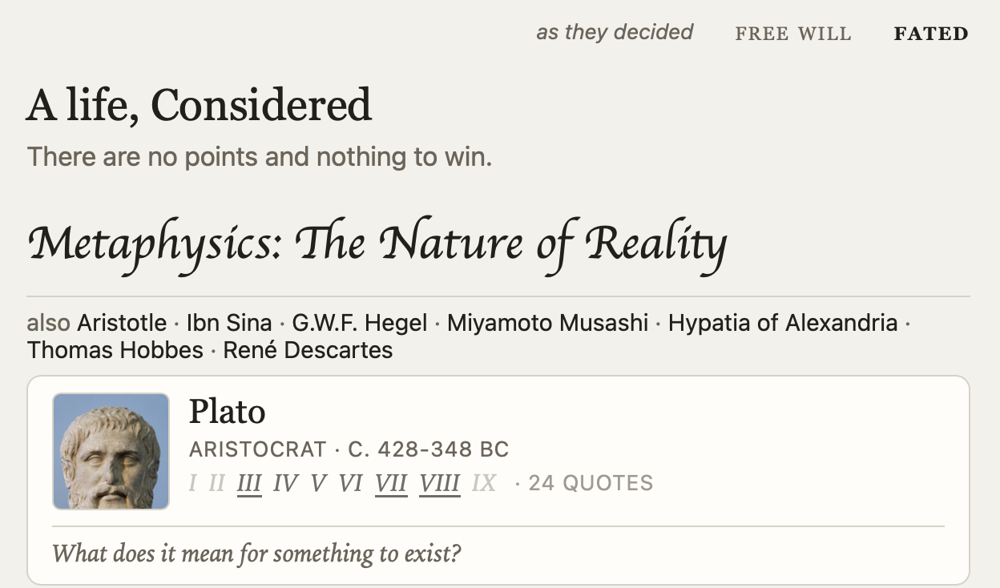

<a class="site-preview-link" href="https://philosophy-lives.vercel.app/">
  
  Click to navigate to philosophy-lives site &rarr;
</a>

**Preface I**

Whenever I'm teased with the idea of reading more philosophy I swing between three modes. 

A) Reading superficial quotes, cards.  B) buying a textbook, signing up for courses, or C) trying to read the original.

In A), it’s often a couple of scrolls and I think I understand things but really I don’t. Except for memes, I understand [memes.](https://www.reddit.com/media?url=https%3A%2F%2Fpreview.redd.it%2Fthe-unexamined-meme-is-not-worth-posting-v0-bnlvdazbk6uc1.jpeg%3Fwidth%3D1080%26crop%3Dsmart%26auto%3Dwebp%26s%3D8f5f2f9adfaa096b6ce9ee77a5041fb7a61b2b9e)

In B) I'm engaged for a bit, but there's always a demoralising drop off.

In C) on occassions I manage. But it's a certain (*unpleasant*) state of mind that persists which ironically, enables success in C.

This is not a Philosophy learning app. It’s also not a course. It’s an idea I dreamed up on the subway at 11pm some summer months back when I was oscillating between B and C, but was not ready to commit to either.

Human minds are blobs of grey matter climbing and falling on different levels of the Maslows hierarchy of needs. The irony (again) is that if you have occasionally have the luxury to escape the lower levels and peek into the highest level of hierarchy, then you might be mortally trapped there. 

Unless you can climb out of the pyramid completely, spread your wings and fly away. Is that even possible?

I “made” (*vibed*) this site with the idea that the great philosophers, while genetically brilliant (*doomed*) individuals, have a story which causes their neural circuits to fire a certain way (*trapped*).

---

**Preface II**

When we read or hear something, shouldn't we always try to understand the context in which it was said?

> From no age are we shut out. 
> If by greatness of mind, we are able to pass beyond the narrow limits of human weakness, 
> there is a great stretch of time through which we may roam.
>
> <cite>— Seneca, <em>On the Shortness of Life</em></cite>
{: .pull-quote}

**Disclaimer I**

AI Generated text on [philosophy-lives](https://philosophy-lives.vercel.app) makes me feel inauthentic, but i have spent so much time editing, auditing, grinding over the content correctness, the interactions, design that I feel authentic as an editor. There are some fully human written parts - the originals where they land in non-copyright public domain. Aside from that, anything that puts you off, is solely the editor's fault.

**Disclaimer II**

There are no points and nothing to win.

**Disclaimer III**

I understand nothing.
