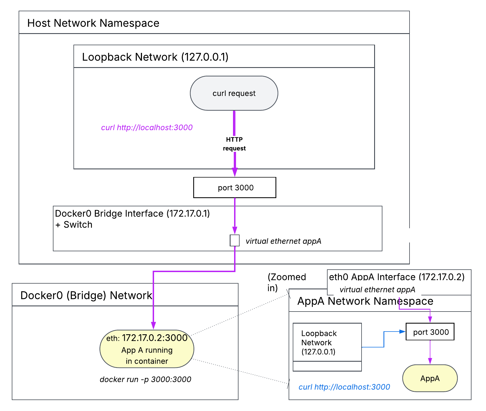
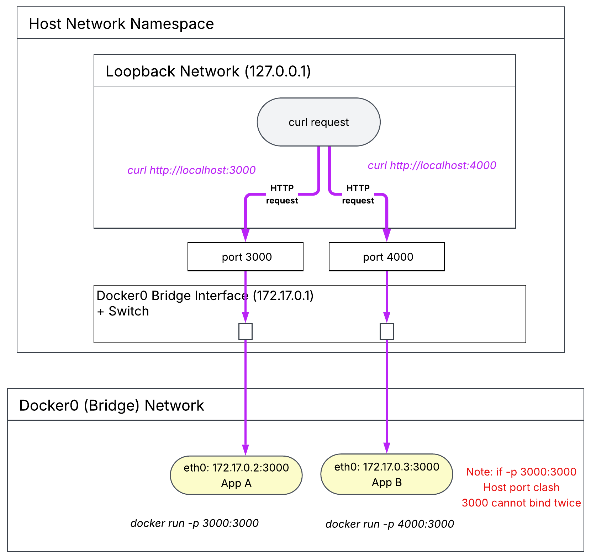
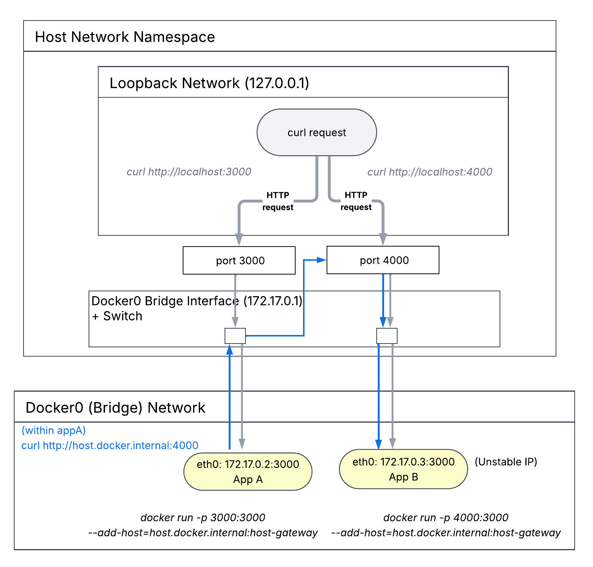
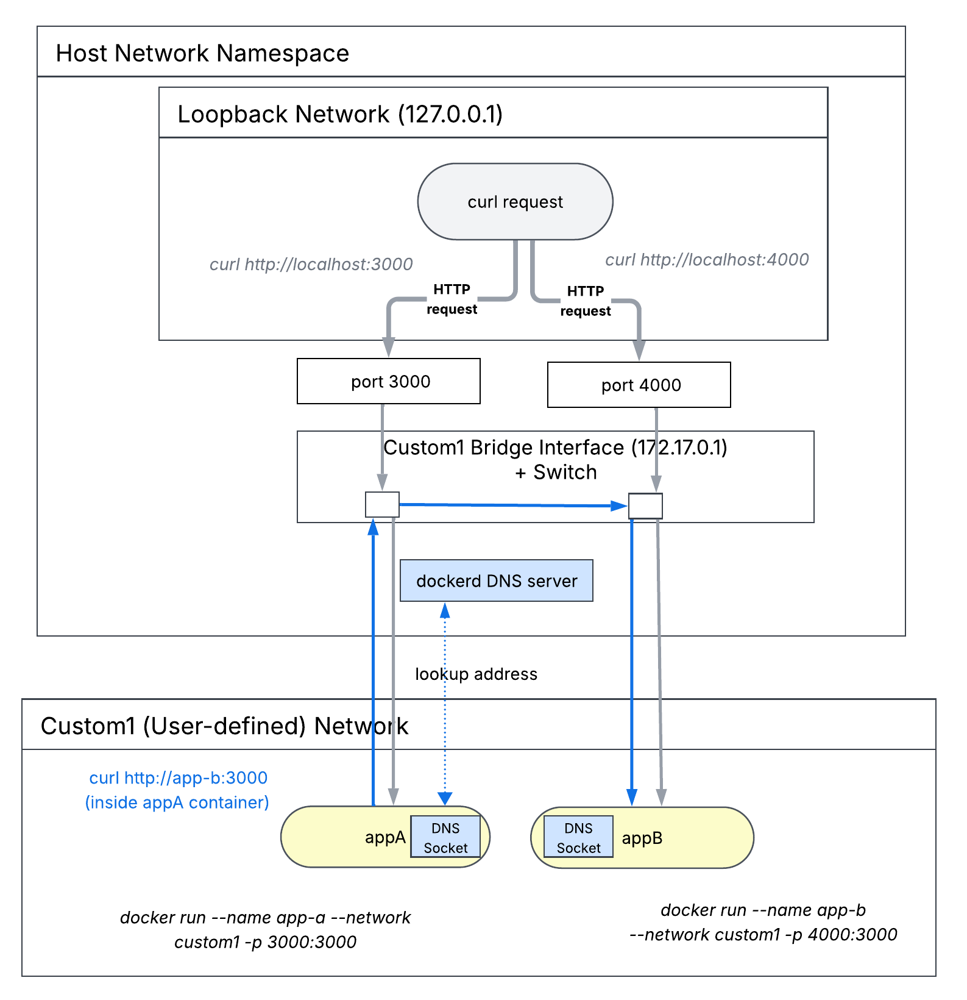
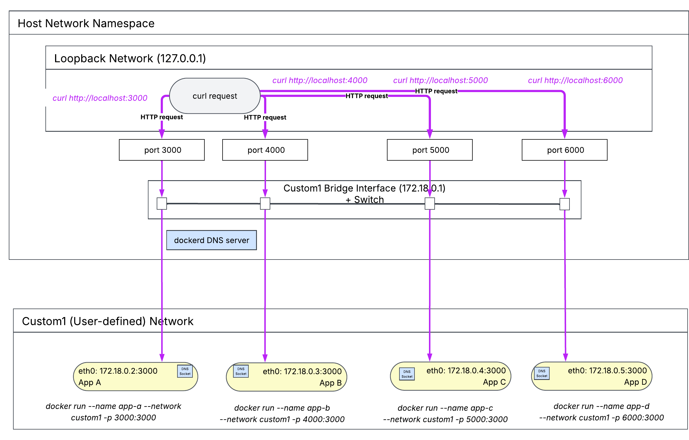
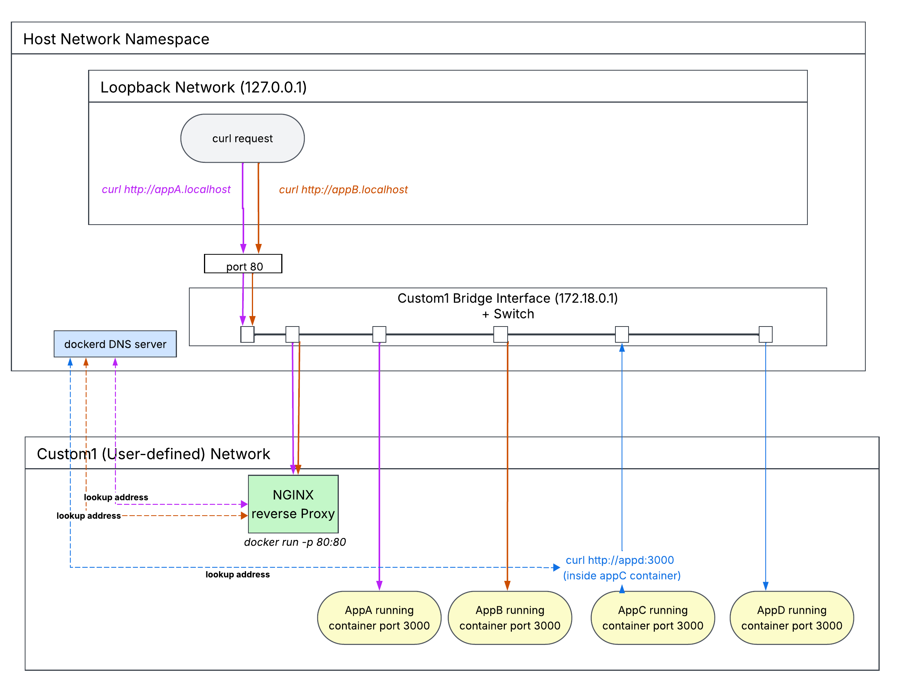

#### **Preview**

I've revamped my entire docker networking setup for working with very large and complex end-to-end systems that chain multiple services together each running in their own docker networks, subnetworks and containers.

Pre AI LLM era, it may have been sufficient to just guarantee the output of your service. However these days, that operational model no longer holds when the output of your service is a non-deterministic response, which will in turn be ingested by another non-deterministic system and have cascading effects. Thus we need to be able to perturb various parts of the system and study the whole chain end-to-end locally.

At the end of the day, we want 
1. to enable M x N way connections across containers, 
2. have these dynamically updated whenever we add a new service enabling smooth A/B testing, 
3. avoid stomping on each other's host ports 
4. avoid calling the wrong service due to changing IP addresses.

*Disclaimer: I'm no networking or security engineer, though I did muck around with devops and dockerfiles by hand before LLM era. This is not a suggestion on how to organise production networks. All diagrams and writing in this post are fully human, but fact-checked with AI.*

 
#### **Single service stack, single port**

There are two ways to start a service stack: `docker run`, and `docker compose`.

`run` and `compose` both run images, with `run` typically relying on CLI flags and `compose` being a declarative config file. Both are flexible enough to work for either single or multiple services. `run` is typically used for one-off containers, whereas `compose` is favored for multi-container lifecycle. The latter also creates a user-defined network by default which has DNS - but more on that later. 

In docker, if you did `docker run appA`, the containers will get created in the default `bridge` network (whose host-side interface is `docker0`). A command like `docker run -p <hostPort>:<containerPort>`, `3000:3000` Means that anything that hits the `localhost:3000` is routed to the container in the docker0 Network, via the docker0 bridge Interface (172.17.0.1). 

A veth pair (one end stays on the host attached to docker0, the other is moved into the container and renamed eth0) is constructed as a 1:1 mapping and is how the host talks to the container across namespaces. 

{: style="max-width: 80%; height: auto;"}

*Note:* 

1. this diagram shows how it would look with linux, but on MacOS it's an additional hop into Docker's Linux VM.
2. `-p 3000:3000` listens on `0.0.0.0` and is exposed to the entire LAN, because Docker writes its own iptables rules and published ports bypass host firewall rules (e.g. `ufw`) on Linux. I'm just using the shortform for diagraming convenience, but it should be `-p 127.0.0.1:3000:3000` to restrict access to local machine.
3. The Docker0 bridge interface sits on the host network namespace, as the host kernel does the routing.

 

#### **Multiple services need to open more host ports**

If we tried to start a second container, appB with `docker run -p 3000:3000 appB`, we would get some message like *"Bind for 0.0.0.0:3000 failed: port is already allocated"*. This refers to the host port being already allocated (not the container port). This is a pretty typical case as many docker containers default listening ports are `3000`, `4000`, `8000`, `8080`, and people just copy the same number onto the host port by convention.

So we open a new port `4000` on the host, `docker run -p 4000:3000`, and we can now send a request to appB with `curl http://localhost:4000`. 

{: style="max-width: 80%; height: auto;"}

 

#### **But how do containers reach each other?**

You would expect appA and appB running in the Docker0 Bridge Network to talk to each other directly.

The problem is appA and appB's IP addresses, although directly reachable, are unknown to each other. We could register them explicitly, but since IP addresses may change on a restart, that breaks easily.

appA does know that appB is registered on the host port `4000`. A request from A to B (within appA) looks like `curl http://host.docker.internal:4000`. 
1. `host.docker.internal` resolves to the docker0 bridge IP (172.17.0.1), which is the host's own address on that bridge. 
2. The request leaves appA through veth and arrives at the host on port `4000`
3. Docker forwards it back through docker0 to appB at `172.17.0.3:3000`.

{: style="max-width: 80%; height: auto;"}

This is clearly a roundabout way for A to call B. Shouldn't we be having a **live dynamic registry of the IP Addresses in the network**, so that A and B can call each other without going back out to the host network? Our registry also needs to handle app restarts and changing IP addresses... Well basically, we want the Domain Name System (DNS). 

*Note*:
1. Only Linux needs to specify `--add-host=host.docker.internal:host-gateway`, as Docker Desktop (Mac/Windows) provides this by default. On Docker Desktop it resolves to the VM's gateway IP (e.g. 192.168.65.254), not docker0, but the roundabout path is the same.

 

#### **User-defined network with built-in DNS**

All user created docker networks, ship with a DNS, but the default `docker0` network if you don't specify anything does not! This is mostly a *legacy issue for backward compatibility*  since Docker 1.0 had shipped without DNS.  

We can create the custom network, and start each container on it with `--network`. 

`docker network create custom1`

Then, run both apps on `custom1`, each with a name (which is its DNS name)

`docker run -d --name app-a --network custom1 -p 3000:3000 <image-a>` \\
`docker run -d --name app-b --network custom1 -p 4000:3000 <image-b>` 

{: style="max-width: 80%; height: auto;"}

Now containers can talk to each other by resolving the app names to the IP addresses using the DNS inside custom1. 

within appA, `curl http://app-b:3000` will hit the DNS, get app-B's IP address (172.18.0.3) , and then send the request via the Custom1 Bridge Interface (virtual switch) to hit appB, without going through port `4000` on the machine host.

*Note:*
1. `dockerd` stands for the docker daemon, its the background service that manages all the docker objects.
2. When chaining multiple services, we might have multiple docker compose files. Each would normally spawn its own custom network, but we can bring them all into the same network with a local-dev override file, e.g., with `networks: default: {name: custom1, external: true}`

 

#### **Containers are talking, but how does the host talk to each container?** 

The custom network got us a DNS for free, but each of our containers still needs to be published at the host port with `-p` to allow our host to call them. We need to test individual services and also the e2e service, so every container needs its own entry point from the host. 

{: style="max-width: 80%; height: auto;"}

This is still a maintenance burden as we need to be tracking which port is associated with which container inside the docker network. Wouldn't it be great if we could **directly start up new containers, and hit the container services reliably from the host without explicitly managing the mapping of which container is on which port.**

It would be great if the host could resolve the name via the dockerd DNS, e.g., with `curl http://app-a:3000`, and get the IP address for the container. However the DNS server is not a global directory. Although dockerd process (running the DNS server) lives on the host, its listening socket sits inside each container's own network namespace. So the host has no address it can send the DNS queries to.

*Note:*
1. Technically in linux the host can reach containers directly by IP e.g., it could hit appB by `curl http://172.18.0.3:3000`. However since the IP addresses may change on restart and there's no name lookup, it's also not a reliable path. Also, it doesn't work on Docker Desktop (Mac/Windows) and is not a generic development workflow.

 

#### **Reverse proxy on a user-defined network**

A reverse proxy (such as nginx) allows us to route traffic from a central location, e.g., port 80, without needing to do `-p` per container app. The nginx reverse proxy is itself a docker container running inside the dev network, and is the only container that publishes a host port:

`docker run -d --name proxy --network custom1 -p 127.0.0.1:80:80 nginx`  

With no port in the URL, curl defaults to port `80`, so a command like `curl http://appA.localhost` becomes
1. `*.localhost` resolves to `127.0.0.1` on the host and goes to port `80`
2. Docker bridge forwards it to the nginx container IP on port 80. 
3. nginx reads the `Host: appA.localhost` header, and the nginx config maps that header to an upstream `proxy_pass http://app-a:3000` (the hostname is arbitrary; the upstream is the container name).
4. nginx resolves the name `app-a` through Docker's embedded DNS at 127.0.0.11, which sits inside the container's network namespace.

The nginx conf looks like


  server {
    listen 80;
    server_name appA.localhost;
    resolver 127.0.0.11 valid=10s;
    set $upstream http://app-a:3000;
    location / { proxy_pass $upstream; }
  }


{: style="max-width: 80%; height: auto;"}

*Note:*
1. It's called reverse proxy because it's a proxy that sits in front of services, in contrast with the forward proxy which acts for the client.
2. In nginx, we need to point nginx at Docker's DNS with `resolver 127.0.0.11` and use a variable in `proxy_pass`, which forces a lookup at request time. Without that nginx resolves once at startup and caches the IP, which goes stale when the container restarts.
3. Other reverse proxy options include Traefik, Caddy. Traefik finds containers automatically from Docker labels so there's no need to maintain an additional nginx config, but there's an additional security risk of Traefix having access to the full Docker sockets API.
4. `*.localhost` resolving to 127.0.0.1 is done by browsers and curl. However going through the system resolver (Python `requests`, `wget`, `ping`) fail because the macOS resolver doesn't map `*.localhost`. Those need to set the header e.g. `requests.get("http://localhost", headers={"Host": "appA.localhost"})`. 

 
#### **Conclusion**

Back to our initial goals and what this set up gives us: custom networks with DNS give M×N container-to-container calls by name which avoids IP churn. The reverse proxy means only one host port is published, so there's no port stomping, and every service can still be hit individually from the host. For working with A/B versions of microservices, dynamic registration when new services come online is only partially addressed as a nginx config file still need to be maintained.

Overall I find that perhaps the most confusing thing about docker networking, as with most of programming abstractions, *is that there are multiple ways to achieve the same thing*, and so we're always trading off the complexity of layered abstraction, isolation and hierarchies, with the complexity (and security risks) of mapping MxN way connections in flat files.

 

#### **References**
[Docker Docs: Networking overview](https://docs.docker.com/engine/network/)\\
[Docker Docs: Bridge network driver (default vs user-defined bridges)](https://docs.docker.com/engine/network/drivers/bridge/)\\
[Docker Docs: Packet filtering and firewalls (iptables, published ports)](https://docs.docker.com/engine/network/packet-filtering-firewalls/)\\
[Docker Docs: Networking in Compose](https://docs.docker.com/compose/how-tos/networking/)\\
[nginx Docs: resolver directive](https://nginx.org/en/docs/http/ngx_http_core_module.html#resolver)\\
[RFC 6761: Special-Use Domain Names (.localhost)](https://www.rfc-editor.org/rfc/rfc6761#section-6.3)
